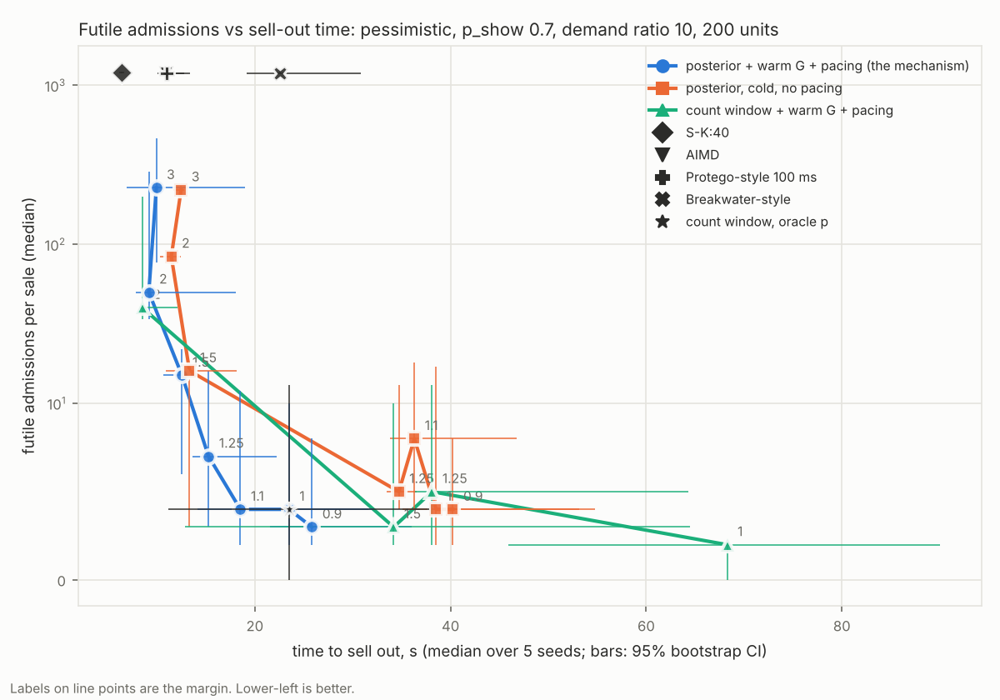
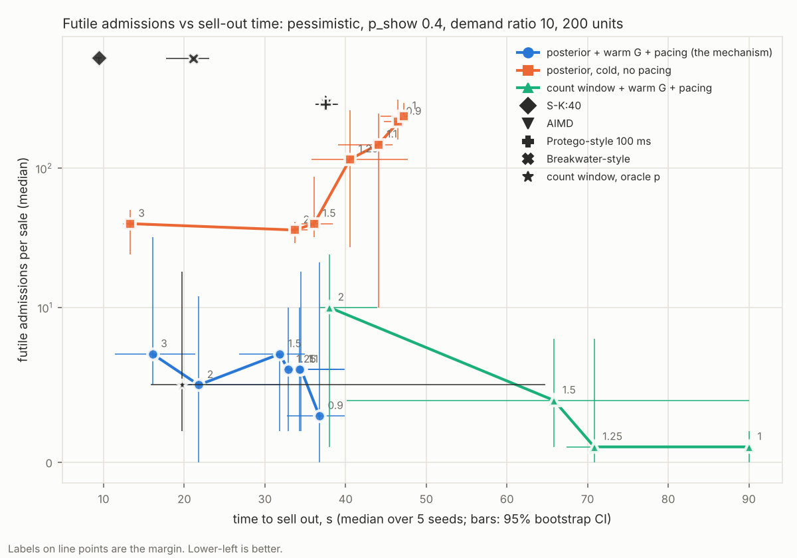

# Morning report: futility-aware admission, overnight run of 2026-10-30

> Round 5 (demand ratio 3) added on 2026-11-02, on top. Round 4 (p 1.0, optimistic) added 11:05 UTC on 2026-11-01. Round 3 (weighting isolated, wrong priors) added 06:30 UTC; round 3b (warm-p margin gap) added 06:45 UTC. Round 2 (frontier grids at p 0.7 and 0.4, k6) added 13:30 UTC on 2026-10-31. Round 1: final first-pass numbers (360 of 360 runs), updated 02:40 UTC; P6 added 03:15 UTC.

Branch: `research/futility-admission` (pushed; nothing pushed to `main`, no force-push, no history rewritten).
Plan: https://claude.ai/artifact/LxT22SaYwRGUTc3Wr79bBm . Every decision with its reasons: [`DECISIONS.md`](DECISIONS.md). How to run everything: [`README.md`](README.md).

# Round 5 (2026-11-02): demand ratio 3

> Design in DECISIONS.md D30. 81 runs (`results/fa/grid/main07r3.jsonl`), invariant held in 81 of 81. Figure and full table: [`main07r3`](../results/fa/frontier/main07r3.md) ([png](../results/fa/frontier/main07r3.png)). Pessimistic, p_show 0.7, demand ratio 3 (600 buyers, 200 units), medians [95% bootstrap CI] over 5 seeds.

| arm | time to sell out, s | futile | admitted |
|---|---|---|---|
| S-K:40 | 6.5 [6.4, 6.5] | 220 [219, 233] | 600 [600, 600] |
| AIMD | 11.8 [10.3, 12.8] | 220 [219, 233] | 600 [600, 600] |
| Protego-style 100 ms | 10.7 [10.2, 12.7] | 220 [219, 233] | 600 [600, 600] |
| Breakwater-style | 10.5 [9.9, 13.2] | 220 [219, 232] | 600 [600, 600] |
| count window, oracle p | 23.5 [11.5, 36.6] | 4 [0, 13] | 287 [287, 296] |
| warm p, margin 1.25 | 10.5 [9.1, 12.9] | 23 [10, 29] | 310 [301, 319] |
| warm p, margin 2.0 | 6.9 [6.4, 7.6] | 74 [55, 107] | 378 [369, 435] |
| warm-G, margin 1.25 | 17.5 [14.2, 22.1] | 5 [2, 13] | 291 [276, 307] |
| warm-G, margin 2.0 | 8.1 [7.7, 8.7] | 41 [35, 44] | 338 [333, 341] |
| warm-G, margin 3.0 | 7.0 [6.7, 8.0] | 78 [69, 159] | 391 [381, 502] |

* **At ratio 3 the mechanism matches S-K:40 on speed within the CIs**: warm p at margin 2.0 sells out in 6.9 [6.4, 7.6] s against 6.5 [6.4, 6.5] s, with 74 futile against 220. Warm-G at margin 3.0: 7.0 s with 78. This is the only cell where any window arm reaches S-K's sell-out time.
* With less excess demand, every baseline admits all 600 buyers, so their futile count is fixed at about 220; the window arms have 3 to 78 depending on start and margin.
* The warm-p vs warm-G pattern is the same as at ratio 10: warm-G gives the lower-futile points at a given speed (e.g. 8.1 s with 41 vs warm p's 7.7 s with 48 at margin 1.5).
* One run (`cwp:1.1:warm:pace`, seed 4) sold 199 of 200: the run ended before the deadline with every buyer resolved and one unit unsold.

---

# Round 4 (2026-11-01): two more cells, p 1.0 and the optimistic strategy

> Design in DECISIONS.md D29. 162 runs (`results/fa/grid/main10.jsonl`, `main07opt.jsonl`), invariant held in 162 of 162. Figures and full tables: [`main10`](../results/fa/frontier/main10.md) ([png](../results/fa/frontier/main10.png)), [`main07opt`](../results/fa/frontier/main07opt.md) ([png](../results/fa/frontier/main07opt.png)). Demand ratio 10, 200 units, medians [95% bootstrap CI] over 5 seeds. **Default for the main figure (D29): both warm starts plotted**, as in these figures and the `*_warmp` ones.

| | pessimistic, p 1.0: time, s | futile | optimistic, p 0.7: time, s | futile |
|---|---|---|---|---|
| S-K:40 | 5.3 [5.1, 6.1] | 1800 [1793, 1800] | 6.9 [6.5, 8.3] | 1202 [1183, 1223] |
| AIMD | 9.6 [9.2, 12.6] | 1800 [1798, 1800] | 11.6 [11.1, 13.2] | 1084 [889, 1212] |
| Protego-style 100 ms | 9.6 [9.0, 12.1] | 1800 [1800, 1800] | 13.0 [11.1, 33.3] | 1192 [847, 1214] |
| Breakwater-style | 25.8 [21.8, 30.7] | 1797 [1793, 1800] | 26.3 [20.9, 29.1] | 1199 [1172, 1221] |
| count window, oracle p | 26.7 [20.2, 31.6] | 1 [0, 1] | 22.6 [11.4, 37.8] | 5 [0, 13] |
| cold posterior, margin 1.0 | 26.6 [19.8, 31.0] | 1 [1, 3] | 38.5 [34.9, 53.3] | 4 [2, 17] |
| warm p, margin 1.0 | 22.3 [15.3, 23.9] | 3 [2, 4] | 35.6 [33.9, 45.2] | 2 [2, 7] |
| warm p, margin 1.1 | 10.1 [8.8, 10.4] | 19 [16, 21] | 30.7 [10.8, 37.7] | 3 [1, 17] |
| warm p, margin 1.25 | 7.5 [7.0, 8.2] | 40 [38, 42] | 10.1 [8.7, 11.0] | 26 [19, 29] |
| warm p, margin 1.5 | 6.7 [5.9, 9.0] | 76 [73, 85] | 8.1 [7.5, 11.7] | 49 [43, 62] |
| warm-G, margin 1.0 | 22.0 [15.3, 32.1] | 3 [1, 8] | 23.6 [19.8, 31.9] | 3 [2, 11] |
| warm-G, margin 1.25 | 8.0 [7.2, 8.4] | 37 [35, 39] | 15.0 [13.2, 22.1] | 8 [2, 17] |
| warm-G, margin 1.5 | 6.8 [5.9, 7.3] | 74 [71, 79] | 14.0 [12.1, 17.1] | 16 [4, 236] |
| warm-G, margin 2.0 | 10.0 [6.5, 10.9] | 137 [123, 157] | 8.0 [7.6, 13.9] | 47 [37, 208] |

* **The frontier holds in both cells.** Every window point has 1 to 240 futile admissions (median; the 240 is warm-G at margin 3.0, p 1.0) against 1,084 to 1,800 for the four baselines.
* **p 1.0 is the closest the mechanism gets to S-K:40 on speed:** margin 1.5 sells out in 6.7 s (warm p) and 6.8 s (warm-G) with 74 to 76 futile, against S-K's 5.3 s with 1,800. Margin 2.0 is slower than 1.5 here (9.1 s and 10.0 s): more admitted buyers contend for the last units. At p 1.0 the two warm starts are indistinguishable, as expected with no no-shows.
* **At p 1.0, "futile" is simply overshoot**: every admitted buyer shows, so futile is about admitted minus 200 (e.g. margin 1.25 admits 240 with 40 futile).
* **Optimistic p 0.7 repeats the pessimistic p 0.7 pattern** (round 3b): warm-G gives the faster low-futile points (margin 1.25: 15.0 s with 8 futile; warm p needs margin 1.1 and 30.7 s for 3), and warm p the faster high-futile ones. Warm-G's CIs are wide at margins 1.5 and 2.0 (16 [4, 236], 47 [37, 208]).
* Process note: the first launch stopped at seed 2 because the grid lacked the cold `cwp:1.0` arm whose runs seed the next seed's prior. It was added and the grid resumed (D29); no completed run was redone or dropped.

---

# Round 3 (2026-11-01): is it the weighting, and what a wrong prior does

> Design in DECISIONS.md D27. 90 runs (`results/fa/grid/round3_07.jsonl`, `round3_04.jsonl`), invariant held in 90 of 90. Paired tables: [`results/fa/grid/round3_summary.md`](../results/fa/grid/round3_summary.md) (`python -m scripts.fa_round3`). Pessimistic, demand ratio 10, 200 units, medians [95% bootstrap CI] over 5 seeds.

## Headline

**With the same warm-p start, the count window is as good as the posterior weighting everywhere except margin 1.0.** Round 2's "posterior helps at p 0.4" compared a count window with a warm-G start against a posterior window with a warm-G start; with a warm-p start for both, the gap disappears at margins 1.25 to 2.0. The posterior weighting helps only at margin 1.0, where the count window stalls on the last units:

| | p 0.7: count | p 0.7: posterior | p 0.4: count | p 0.4: posterior |
|---|---|---|---|---|
| margin 1.0, time to sell out, s | 65.3 [37.1, 90.0] | 34.4 [33.5, 43.1] | 66.3 [31.0, 90.0] | 37.9 [35.0, 40.5] |
| margin 1.0, futile | 2 [1, 5] | 3 [2, 7] | 2 [1, 3] | 4 [2, 19] |
| margin 1.25, time, s / futile | 9.4 / 23 | 9.3 / 22 | 13.2 / 12 | 17.2 / 7 |
| margin 1.5, time, s / futile | 7.7 / 48 | 8.2 / 41 | 8.9 / 49 | 10.0 / 47 |
| margin 2.0, time, s / futile | 6.8 / 103 | 7.5 / 106 | 12.4 / 96 | 13.3 / 103 |

(CIs for the margin 1.25 to 2.0 rows are in the summary file; they overlap pairwise in every row.) My reading, not tested separately: with a warm p and no seeded G, the posterior window has no G until a cohort matures at about 30 s, so before then it is a count window; after 30 s the age discount releases the slots held by old unshown claims, which is what rescues the margin 1.0 tail. **For the paper this means the frontier's gain comes from the warm p and pacing; the posterior weighting is an endgame fix at the strict margin, not the source of the frontier.**

**A wrong prior hurts in the direction you would expect for warm p, and unpredictably for warm-G.**

| arm | p 0.7 sale, right prior (p 0.7) | p 0.7 sale, wrong prior (p 0.4) | p 0.4 sale, right prior (p 0.4) | p 0.4 sale, wrong prior (p 0.7) |
|---|---|---|---|---|
| warm p, margin 1.25 | 9.3 s, 22 futile | 6.9 s, 126 [58, 160] futile | 17.2 s, 7 futile | 35.5 s, 27 [12, 31] futile |
| warm p, margin 2.0 | 7.5 s, 106 futile | 7.6 s, 247 [125, 302] futile | 13.3 s, 103 futile | 31.2 s, 7 [7, 17] futile |
| warm-G, margin 1.25 | 15.3 s, 7 futile | 31.4 s, 3 [1, 4] futile | 32.9 s, 6 futile | 22.2 s, 2 [1, 13] futile |
| warm-G, margin 2.0 | 9.2 s, 50 futile | 7.6 s, 47 [35, 55] futile | 21.8 s, 5 futile | 14.0 s, 191 [6, 393] futile |

* **Warm p, prior too low** (seeded from a p 0.4 sale, run at p 0.7): futile admissions rise about 2 to 6 times (22 to 126 at margin 1.25, 106 to 247 at 2.0), still far below the baselines' about 1,190 in this cell.
* **Warm p, prior too high** (from p 0.7, run at p 0.4): it sells out about 2 times slower (17.2 to 35.5 s, 13.3 to 31.2 s), close to the cold arm (cold `cwp:1.25:pace` at p 0.4: 35.7 s).
* **Warm-G does not move consistently.** Sometimes the wrong prior is slower with fewer futile (p 0.7, 1.25), sometimes faster with fewer (p 0.4, 1.25), and once much worse with a very wide CI (p 0.4, 2.0: 191 [6, 393] futile). I can't explain this from the data I have.

## Round 3b: warm p against warm-G, with the margin gap filled (D28)

The first warm-p frontier plot had no warm-p point between margins 1.0 and 1.25, exactly where warm-G has its low-futile points, so round 2's "warm p is as good or better than warm-G" was not supported there. Round 3b ran warm p at margins 1.05, 1.1 and 1.15 (30 runs, invariant held in all; `results/fa/grid/round3b_*.jsonl`). Figures: [`frontier07_warmp.png`](../results/fa/frontier/frontier07_warmp.png), [`frontier04_warmp.png`](../results/fa/frontier/frontier04_warmp.png), tables next to them.

| | p 0.7, warm p | p 0.7, warm-G | p 0.4, warm p | p 0.4, warm-G |
|---|---|---|---|---|
| about 3 to 4 futile | 30.8 s (1.1), 3 [1, 15] | 23.5 s (1.0), 4 [2, 10] | 37.9 s (1.0), 4 [2, 19] | 34.5 s (1.0), 6 [2, 18] |
| about 5 to 8 futile | 18.4 s (1.15), 8 [2, 23] | 15.3 s (1.25), 7 [3, 16] | 32.9 s (1.15), 5 [0, 25] | 21.8 s (2.0), 5 [0, 12]; 16.1 s (3.0), 7 [5, 32] |
| fastest measured | 7.5 s (2.0), 106 [67, 116] | 9.2 s (2.0), 50 [34, 285] | 10.0 s (1.5), 47 [5, 65] | 16.1 s (3.0), 7 [5, 32] |

(Margin in brackets after the time. Times are medians; time CIs are in the tables.)

* **This corrects round 2 and the first round-3 recommendation.** In the low-futile region that is the paper's claim (under about 10 futile), warm-G sells out as fast or faster than warm p in both cells: at p 0.7 15.3 s vs 18.4 s for 7 to 8 futile; at p 0.4 21.8 s vs 32.9 s for 5 futile. The CIs are wide and overlap at p 0.7 (warm p 1.15: [10.1, 32.7] s; warm-G 1.25: [13.6, 22.2] s).
* **Warm p reaches faster points by admitting more** (p 0.7: 7.5 s with 106 futile; p 0.4: 10.0 s with 47), and its knob is touchy: between margins 1.05 and 1.15 the time CIs span about 10 to 34 s at p 0.7, i.e. some seeds sell out fast and others stall.
* **So neither start dominates.** Warm-G gives the better low-futile end; warm p is simpler, degrades predictably under a wrong prior, and does not need pacing to avoid collapse (warm-G does, round 2).

## What this changes

* The posterior weighting is worth keeping for its margin 1.0 endgame, not as the headline; with the same start, the count window matches it elsewhere.
* Warm-G gives the best low-futile points but has two measured fragilities (no pacing: collapse; wrong prior: inconsistent). Warm p is the robust fallback. Which one the main figure leads with is Ramkiran's call.
* A warm start needs a guard for a shifted p. The cheapest candidate is a prior with a small pseudo-count so the sale's own evidence overrides it quickly. That is untested.
* Not run yet: optimistic strategy, p 1.0, demand ratio 3 (D27).

---

# Round 2 (2026-10-31): the frontier, warm starts, latency split, pacing, k6

> Added after Ramkiran's five decisions (DECISIONS.md, "Round 2", D20 to D25). Round 1 follows unchanged below.

## Headline

**With a warm start and pacing, the posterior-weighted window traces a frontier that is below every baseline on futile admissions, and faster than AIMD, Protego-style and Breakwater-style at its fast end. It never reaches S-K:40's sell-out time.** Pessimistic, demand ratio 10, 2,000 buyers, 200 units, medians over 5 seeds [95% bootstrap CI of the median]:

| | p_show 0.7: time to sell out, s | futile | p_show 0.4: time to sell out, s | futile |
|---|---|---|---|---|
| S-K:40 | 6.4 [6.2, 6.7] | 1202 [1183, 1223] | 9.4 [9.0, 9.8] | 618 [568, 629] |
| AIMD | 10.9 [10.5, 12.8] | 1188 [1155, 1214] | 37.6 [36.3, 39.1] | 289 [261, 328] |
| Protego-style 100 ms | 11.0 [10.0, 13.4] | 1192 [1155, 1216] | 37.5 [36.2, 38.9] | 289 [261, 333] |
| Breakwater-style | 22.6 [19.1, 30.8] | 1196 [1182, 1222] | 21.1 [17.7, 23.1] | 611 [568, 627] |
| count window, oracle p | 23.5 [11.1, 37.9] | 4 [0, 13] | 19.7 [15.8, 64.8] | 5 [2, 18] |
| mechanism, margin 1.0 | 23.5 [19.0, 32.1] | 4 [2, 10] | 34.5 [32.6, 39.8] | 6 [2, 18] |
| mechanism, margin 1.25 | 15.3 [13.6, 22.2] | 7 [3, 16] | 32.9 [32.4, 39.9] | 6 [2, 10] |
| mechanism, margin 1.5 | 12.6 [10.6, 14.0] | 15 [6, 22] | 31.8 [26.8, 34.9] | 7 [2, 7] |
| mechanism, margin 2.0 | 9.2 [7.8, 18.0] | 50 [34, 285] | 21.8 [19.4, 31.9] | 5 [0, 12] |
| mechanism, margin 3.0 | 9.9 [6.9, 19.0] | 227 [77, 466] | 16.1 [11.4, 21.4] | 7 [5, 32] |
| warm p only + pacing, margin 1.25 | 9.3 [9.1, 13.8] | 22 [8, 38] | 17.2 [11.7, 31.4] | 7 [1, 28] |

"Mechanism" = posterior weighting + warm-G start + pacing (`cwp:<m>:warmg:pace`). Futile = admitted buyers who showed and got no unit (sold out at checkout, expired while waiting, or turned away at the gate; D24). Full tables with every arm and every latency column: [`frontier07.md`](../results/fa/frontier/frontier07.md), [`frontier04.md`](../results/fa/frontier/frontier04.md).




In the p 0.4 figure the AIMD marker sits under the Protego-style marker (37.6 s / 289 and 37.5 s / 289).

## What the ablations say

* **The warm p does most of the work, not the age discount.** A warm p alone (`cwp:<m>:warm:pace`, no seeded G) is as good or better than warm-G at the points measured: at p 0.7, margin 1.25 gives 9.3 s with 22 futile, against warm-G's 9.2 s with 50 at margin 2.0; at p 0.4, margin 1.25 gives 17.2 s with 7, against warm-G's 16.1 s with 7 at margin 3.0 and 32.9 s with 6 at 1.25. Warm-G is the more conservative of the two at the same margin, so its curve is shifted, not lower. I don't have evidence that the seeded G improves the frontier over a warm p. **Round 3b corrects this: there was a gap in the warm-p sweep, and with it filled warm-G is as fast or faster in the low-futile region (see Round 3b).**
* **Cold posterior stays slow.** With p = 1 until a cohort matures (about 30 s), cold `cwp` takes 34.7 to 40.2 s to sell out at margins 0.9 to 1.25 at p 0.7, and at p 0.4 it over-admits as well (116 to 237 futile at margins 0.9 to 1.25, unpaced). Ramkiran's structural point holds: the cold window has nothing to discount a claim's age with until a cohort matures, so the age weighting cannot act early in a cold sale.
* **Posterior against count weighting, same warm-G start and pacing.** At the same margin the posterior window sells out faster: p 0.7 margin 1.25, 15.3 s vs 38.1 s (futile 7 vs 5); p 0.4 margin 2.0, 21.8 s vs 38.0 s (5 vs 10). At p 0.7 the two curves end up close along the frontier (count margin 2.0: 8.5 s with 40 futile; posterior 2.0: 9.2 s with 50). At p 0.4 the count window never gets below 38.0 s, and at margin 1.0 does not sell out by the 90 s deadline (97.5% sold), so there the posterior weighting does help. I only ran the count window with the warm-G start, so the cause of the gap is not isolated. **Round 3 isolated it: with a warm-p start for both, the gap disappears except at margin 1.0 (see Round 3).**
* **Without pacing, warm-G fails completely.** `cwp:<m>:warmg` (no pacing) admits all 2,000 buyers with 1,192 (p 0.7) and 613 to 614 (p 0.4) futile, i.e. no better than S-K. Under the all-at-once burst, shows reach the door late and the seeded G (from a calm sale) reads them as no-shows (D22). This is a real fragility of age-based inference when the observation path slows under load.
* **Pacing cuts gate wait to about zero and moves client p95 from seconds to hundreds of ms.** Cold posterior at margin 1.25, unpaced vs paced: p 0.7, winner gate wait 0.24 s vs 0.00 s mean, client p95 4,499 ms vs 246 ms, sell-out 34.7 s vs 34.2 s, futile 5 vs 13; p 0.4, client p95 6,918 vs 917 ms, futile 116 vs 48.

## Latency (decision 3)

Primary metric: admission-to-verdict per buyer, minus the buyer's own show delay ("system time"), split into gate wait and DB (handler) time. p 0.7, medians over seeds:

| arm | winner system time p50, s | winner gate wait mean, s | winner DB time mean, s | queue-loser verdict p50, s | client checkout p95, ms |
|---|---|---|---|---|---|
| S-K:40 | 0.29 | 0.00 | 0.031 | 17.6 | 219 |
| AIMD | 0.27 | 0.00 | 0.028 | 50.8 | 55 |
| Protego-style 100 ms | 0.36 | 0.00 | 0.022 | 51.1 | 83 |
| Breakwater-style | 16.75 | 4.72 | 0.042 | 33.3 | 18,528 |
| count window, oracle p (unpaced) | 5.53 | 0.68 | 0.085 | 23.6 | 4,191 |
| mechanism, margin 1.25 | 0.09 | 0.00 | 0.024 | 15.3 | 181 |
| mechanism, margin 2.0 | 0.73 | 0.03 | 0.055 | 9.3 | 968 |
| warm p + pacing, margin 1.25 | 0.19 | 0.00 | 0.042 | 9.4 | 443 |

At p 0.7 the paced warm arms tell queued losers their verdict sooner than S-K:40 (9.3 to 15.3 s vs 17.6 s), because the sold-out notice goes to everyone still queued as soon as the last unit sells. At p 0.4 the warm-G arms do not (21.9 to 33.0 s at margins 1.25 to 2.0, against S-K's 19.2 s and AIMD's 67.4 s); warm p alone at margin 1.25 gets 17.2 [11.8, 31.4] s. The CIs and the p 0.4 columns are in the full tables.

## k6 (decision 5)

Full table: [`results/fa/k6/round2_summary.md`](../results/fa/k6/round2_summary.md) (from `results/fa/k6/round2.jsonl`, `scripts/fa_k6_table.py`). 1,000 k6 virtual buyers, 60 units, pessimistic, p_show 0.7, lognormal show delay median 2 s, one local API process, 3 repetitions; cells are median [min, max] over the 3. Every buyer polls `/queue/status` for real.

| arm | futile (admitted, sold out at checkout) | told sold out in the queue | winner admission-to-verdict p50, ms | gate wait p50 / p95, ms | DB handler p50, ms | client checkout p95, ms | queue-loser verdict p50, ms |
|---|---|---|---|---|---|---|---|
| S-K:40 | 588 [577, 643] | 0 | 5,701 [5,602, 6,824] | 0 / 0 | 1,900 [1,472, 2,362] | 5,045 [4,842, 5,960] | n/a (no notice) |
| AIMD | 616 [601, 644] | 0 | 1,726 [1,565, 2,229] | 0 / 0 | 17 [15, 24] | 3,158 [2,344, 3,171] | n/a (no notice) |
| count window, cold (`cw-censored`) | 3 [1, 8] | 912 [911, 916] | 5,692 [2,294, 5,932] | 87 / 189 | 869 [332, 1,764] | 4,470 [3,672, 4,477] | 42,529 [40,242, 70,860] |
| posterior, cold, seeding sale (`cwp:1.0`) | 3 [0, 9] | 916 [902, 921] | 5,215 [4,918, 5,354] | 73 / 163 | 1,301 [696, 1,603] | 4,151 [3,700, 4,551] | 41,349 [38,514, 45,126] |
| posterior, warm p + pacing, 1.25 | 2 [1, 3] | 905 [896, 906] | 5,104 [4,501, 5,834] | 103 / 160 | 583 [26, 638] | 3,718 [3,249, 4,527] | 15,167 [10,761, 16,099] |
| posterior, warm-G + pacing, 1.25 | 33 [15, 96] | 863 [751, 874] | 5,398 [4,562, 6,450] | 42 / 311 | 132 [23, 318] | 4,036 [3,482, 7,729] | 11,302 [10,267, 16,521] |

* **Futility holds end to end.** Every window arm keeps futile admissions at 0 to 9 per sale except warm-G (15 to 96), against 577 to 644 for S-K:40 and AIMD. 60 of 60 units sold and the database invariant held in all 18 runs.
* **Warm p reaches losers sooner.** Queued losers get the sold-out notice at a median of 15.2 s with warm p (11.3 s with warm-G), against about 41 to 43 s for the cold windows. S-K:40 and AIMD send no notice; their losers find out at checkout.
* **Warm-G is weaker under k6 than in the Python grid.** 33 [15, 96] futile against the grid's 7 at p 0.7 margin 1.25, and one run had a 4.8 s gate wait p50. That is the D22 fragility again (late shows read as no-shows); pacing reduced it but did not remove it here.
* **Latency is not separable from load in this setup.** Winner admission-to-verdict includes the buyer's own show delay (median 2 s) in k6, so it is not the grid's "system time". DB handler p50 is 0.6 to 1.9 s for most arms because 1,000 polling virtual buyers and one API process share 4 cores; AIMD keeps it at 17 ms by holding concurrency down. k6 numbers are only comparable within this table.
* **No sell-out time from k6:** the k6 script does not record when the last unit sold, so speed comparisons come from the grid only.
* **D26, round 1's "other failures" explained:** the local k6 runner used the committed `results/load/users.json`, whose ids came from the docker deployment's database; 270 of its 300 ids do not exist here, and those checkouts got `404 unknown user or sale`. The runner now exports ids from this database; with that fix there were 0 other failures in all 18 runs. The first, invalid attempt is kept in `results/fa/k6/round2_v1_unknown_users/`.

## Decisions D20 to D26 (details in DECISIONS.md)

* D20 posterior weighting: a shown claim counts 1, an unshown claim counts p(1-G)/(1-pG); reduces exactly to the count window with no G.
* D21 three starts: cold (default), warm (previous sale's p_hat), warm-G (also its show delays as G until a cohort matures). In the harness "previous sale" = the cold `cwp:1.0` run of the same cell with the previous seed: a stationarity assumption that favours warm starts.
* D22 grants not yet told keep age 0 (new modes only); still not enough without pacing.
* D23 pacing: token bucket at limit x 1000 / median checkout ms, floor 20/s, capped at one limit.
* D24 frontier grids (p 0.7 then 0.4, 31 arms, 5 seeds + 1 seeding run) and the futile / admission-to-verdict definitions.
* D25 k6 runs: 3 repetitions of a seeding sale + 5 arms, margin 1.25.
* D26 the local k6 runner used user ids that do not exist in this database; fixed, k6 runs restarted.

## Broken, unfinished, or uncertain (round 2)

* **Nothing beats S-K:40 on sell-out time.** The fastest mechanism point is 9.2 s at p 0.7 (S-K 6.4 s) and 16.1 s at p 0.4 (S-K 9.4 s).
* **Warm starts assume the next sale looks like the last one.** The seeding sale is drawn from the same distribution. A shifted p between sales is not tested.
* **Wide CIs at the fast end.** E.g. p 0.7 margin 2.0: futile 50 [34, 285]; margin 3.0: 227 [77, 466]. Five seeds.
* **Optimistic strategy, p 1.0 and demand ratio 3 not run in round 2** (D24).
* **The cause of the posterior vs count gap is not isolated** (no `cwc:<m>:warm` arm).
* Same machine caveats as round 1: one 4-core VM, native Postgres and Redis, one API process, load generator on the same CPU.

## Reproduce (round 2)

```bash
OTEL_SDK_DISABLED=true SALE_WINDOW_ENFORCED=false python -m scripts.fa_benchmark --grid frontier07
OTEL_SDK_DISABLED=true SALE_WINDOW_ENFORCED=false python -m scripts.fa_benchmark --grid frontier04
python -m scripts.fa_frontier results/fa/grid/frontier07.jsonl results/fa/frontier/frontier07
python -m scripts.fa_frontier results/fa/grid/frontier04.jsonl results/fa/frontier/frontier04
OTEL_SDK_DISABLED=true SALE_WINDOW_ENFORCED=false python -m scripts.fa_k6 --reps 3
python -m scripts.fa_k6_table results/fa/k6/round2.jsonl > results/fa/k6/round2_summary.md
```

---


# Round 1

## Headline

**The claim window does what it is meant to do on futility, and costs a lot of speed.** With the censoring-aware estimator (`cw-censored`) and p_show 0.7 or 1.0, admitted buyers who lose at checkout fall from 218 to 1,791 per sale (S-K:40 and AIMD) to a median of 0 to 2. Zero oversells in all 360 runs. But it loses on every time metric in every cell:

* **Sell-out time.** S-K:40 sells out in 5.0 to 10.2 s (medians over 5 seeds). `cw-censored` takes 31.9 to 48.3 s, `cw-oracle` 19.3 to 25.7 s, AIMD 9.3 to 37.9 s.
* **Loser verdict.** Median time until a buyer who will not get a unit is told: S-K:40 7.9 to 19.6 s, `cw-censored` 31.9 to 45.1 s. The claim window beats AIMD on this only at demand ratio 10 and p_show 0.4 or 0.7 (e.g. pessimistic p 0.7: 38.9 vs 47.5 s), and by under a second at optimistic p 1.0, ratio 10 (32.2 vs 33.1 s).
* **Checkout latency.** Client checkout p95 is 2.0 to 9.9 s for `cw-censored` and up to 27.8 s for `cw-naive` (gate wait from admitting the whole budget at once, D8), against 32 to 726 ms for AIMD.

Two causes are visible in the data. (1) At p 1.0 the claim window has 95% of units sold by about 12 to 13 s, then waits until about 32 s for the last few admitted buyers, whose show delays are in the lognormal tail (table "time to 95% sold" in the summary). That is the price of admitting only ceil(free/p) buyers: the last units wait for the slowest admitted buyer or a 30 s TTL expiry. (2) At p 0.4 the estimator sits at its prior p = 1 until the first cohort matures, about 30 s in, so `cw-censored` behaves like `cw1` for the first 30 s.

**Where the mechanism loses outright on its own metric:** p 0.4, demand ratio 3, where `cw-censored` loses 39 (pessimistic) and 29 (optimistic) admitted buyers, against 39 for S-K:40 and AIMD, with overlapping CIs, and takes about 39 to 40 s instead of 10. At p 0.4 ratio 10 it loses 172 and 151 against AIMD's 288 and S-K's 614, with CIs ([30, 379], [27, 375]) that overlap AIMD's. The oracle shows what the window could do with a correct p from the start: 3 to 4 lost in those cells.

**Estimator.** At the end of each run the censoring-aware p_hat is within 0.02 of the true effective show rate in every cell. The naive estimator collapses at p 1.0 and ratio 10 (final p_hat 0.66 and 0.72; the arm loses 1,117 and 1,216 admitted buyers, close to having no window) because it counts buyers who have not shown yet as no-shows.

**cw1 (window with p fixed at 1) is not live with no-shows:** 79.5 to 80.0% sold by the 90 s deadline at p 0.4 and 98.5% at p 0.7, as expected.

## What got done, by phase

**P0, guard and baselines.** `tests/test_frozen_files.py` pins `app/models.py`, `app/database.py` and the source of the three checkout handlers (SHA-256, line endings normalised); it was committed first and run before every commit. `tests/test_flags_off.py` replays a scenario against a golden trace recorded at `53cf50e` (before any new module existed) and asserts the same responses and Redis keyspace with all flags off. Fresh AIMD baselines on this machine are in `results/fa/p0/`; a single-replica k6 baseline is in `results/fa/k6/` (D2: no Docker daemon, so not the 3-replica setup).

**P1, buyer behaviour.** `scripts/fa_benchmark.py` models no-shows (Bernoulli p_show), show delay (lognormal, uniform or exponential), and payment failures (p_pay, unit released through the existing payments path). The k6 copy `results/fa/load/flashsale_fa.js` has P_SHOW and delay parameters. S-K and AIMD arms run with p_show < 1 in the grid.

**P2, mechanism.** `app/stock_view.py` (free units mirrored into Redis, own one-connection engine), `app/claim_window.py` (`CLAIM_WINDOW=fixed:<p>|oracle|naive|censored`, unresolved set, sold-out notice, `FA_TTL_MODE=fixed` with the clock started at first notification). Hooks in `app/queue.py` and `app/admission.py` only, all behind flags.

**P3, estimator.** `app/show_estimator.py` ports the pilot's `Sim.p_hat`. `tests/test_show_estimator.py` checks exact equality with the pilot's own code on 360 synthetic buyer logs (three delay distributions, three p, 40 trials), plus property tests. The naive ablation is there too.

**P4, decoupled DB limiter.** `app/db_limiter.py` gates checkouts at the door and drives its limit with `admission_control.step()` unchanged (cap 30). A bug in the first version (D15) made the first grid attempt invalid for every limiter arm; it was fixed, regression-tested, and the grid restarted.

**P5, first-pass grid.** Arms S-K:40, AIMD (coupled), CW-1, CW-naive, CW-censored, CW-oracle; pessimistic and optimistic; p_show 0.4, 0.7, 1.0; demand ratio 3 and 10; seeds 1 to 5; 200 units, 90 s deadline, TTL 30 s (D7). Complete: 360 of 360 runs, finished about 02:20 UTC (D19: two container restarts cost about two hours).

**P6, Protego-style and Breakwater-style.** Code done (`app/protego.py`, `DB_LIMITER=breakwater`, D16, D17). Runs at one cell only (D18). Complete: 40 runs, results below.

## Results

Full tables, every cell, with medians and 95% percentile-bootstrap CIs of the median over 5 seeds (10,000 resamples): [`results/fa/grid/firstpass_summary.md`](../results/fa/grid/firstpass_summary.md), generated by `scripts/fa_analyze.py` from `results/fa/grid/firstpass.jsonl`. With 5 seeds the CIs are coarse and can only take values seen in the data. Below, the pessimistic strategy (optimistic is in the same file and tells the same story); tables generated with the same `fmt` function.

**Admitted, then lost at checkout (sold out), median [95% CI]**

| p_show, ratio | S-K:40 | aimd | cw1 | cw-naive | cw-censored | cw-oracle |
|---|---|---|---|---|---|---|
| 0.4, 3 | 39 [24, 48] | 39 [24, 48] | 0 [0, 0] | 39 [24, 47] | 39 [24, 48] | 3 [0, 15] |
| 0.4, 10 | 614 [562, 626] | 288 [258, 331] | 0 [0, 0] | 606 [561, 623] | 172 [30, 379] | 4 [0, 15] |
| 0.7, 3 | 218 [215, 230] | 218 [215, 230] | 0 [0, 0] | 218 [214, 226] | 0 [0, 15] | 4 [0, 10] |
| 0.7, 10 | 1199 [1175, 1217] | 1197 [1161, 1212] | 0 [0, 0] | 1192 [1162, 1202] | 2 [0, 13] | 4 [0, 12] |
| 1.0, 3 | 398 [395, 398] | 398 [395, 398] | 0 [0, 0] | 395 [394, 397] | 1 [0, 1] | 0 [0, 2] |
| 1.0, 10 | 1790 [1717, 1794] | 1791 [1787, 1795] | 0 [0, 0] | 1117 [1005, 1766] | 1 [0, 1] | 0 [0, 2] |

**Time to sell out (or the 90 s deadline), s**

| p_show, ratio | S-K:40 | aimd | cw1 | cw-naive | cw-censored | cw-oracle |
|---|---|---|---|---|---|---|
| 0.4, 3 | 10.2 [9.0, 11.0] | 37.5 [36.3, 39.1] | 90.0 [90.0, 90.0] | 11.8 [10.6, 12.8] | 39.0 [37.4, 39.3] | 20.3 [14.8, 90.0] |
| 0.4, 10 | 9.5 [8.5, 10.4] | 37.5 [36.2, 38.7] | 90.0 [90.0, 90.0] | 23.8 [20.4, 26.1] | 45.0 [39.5, 47.8] | 19.3 [15.0, 66.4] |
| 0.7, 3 | 6.2 [6.1, 6.8] | 10.3 [10.2, 12.9] | 90.0 [90.0, 90.0] | 11.6 [10.0, 12.6] | 48.3 [35.1, 90.0] | 21.4 [12.4, 36.7] |
| 0.7, 10 | 6.3 [6.0, 6.4] | 10.5 [10.0, 12.5] | 90.0 [90.0, 90.0] | 23.0 [20.7, 24.8] | 39.1 [35.9, 90.0] | 22.5 [11.1, 36.7] |
| 1.0, 3 | 5.0 [4.9, 5.5] | 9.3 [8.6, 10.2] | 32.9 [20.3, 38.0] | 11.2 [10.4, 13.7] | 31.9 [19.7, 35.5] | 25.5 [16.9, 30.8] |
| 1.0, 10 | 5.4 [4.9, 5.5] | 9.3 [8.6, 11.1] | 32.9 [19.9, 37.1] | 24.2 [17.4, 27.1] | 31.9 [18.6, 35.3] | 25.7 [17.3, 31.0] |

**Loser verdict p50, s** (when a buyer who will not get a unit learns it; cw1 tells nobody before the deadline at p < 1)

| p_show, ratio | S-K:40 | aimd | cw1 | cw-naive | cw-censored | cw-oracle |
|---|---|---|---|---|---|---|
| 0.4, 3 | 12.6 [10.8, 13.1] | 39.8 [38.3, 41.2] | n/a | 13.9 [12.3, 15.5] | 40.5 [38.8, 41.3] | 18.9 [14.9, 63.1] |
| 0.4, 10 | 19.1 [18.2, 29.7] | 67.3 [64.6, 68.4] | n/a | 28.1 [23.2, 31.8] | 45.1 [39.7, 47.8] | 19.4 [15.0, 66.5] |
| 0.7, 3 | 8.3 [8.1, 9.2] | 13.9 [13.0, 31.9] | n/a | 12.6 [10.9, 14.0] | 43.9 [35.2, 55.1] | 21.4 [12.6, 36.8] |
| 0.7, 10 | 17.7 [17.5, 18.0] | 47.5 [45.3, 53.4] | n/a | 32.6 [31.6, 35.3] | 38.9 [36.0, 55.6] | 22.6 [11.2, 36.7] |
| 1.0, 3 | 7.9 [7.4, 8.1] | 13.0 [11.9, 15.6] | 33.0 [20.4, 38.1] | 13.7 [13.0, 16.7] | 32.0 [19.9, 35.5] | 25.6 [16.9, 30.8] |
| 1.0, 10 | 17.9 [17.0, 39.2] | 24.7 [24.0, 41.3] | 32.9 [20.0, 37.2] | 32.5 [28.9, 43.1] | 32.0 [18.8, 35.4] | 25.8 [17.3, 31.0] |

**Client checkout p95, ms** (includes the DB-limiter gate wait for the claim-window arms)

| p_show, ratio | S-K:40 | aimd | cw1 | cw-naive | cw-censored | cw-oracle |
|---|---|---|---|---|---|---|
| 0.4, 3 | 82 [59, 134] | 63 [46, 140] | 162 [94, 1131] | 2372 [1293, 3623] | 4322 [2067, 4632] | 1453 [1115, 2213] |
| 0.4, 10 | 120 [78, 10115] | 32 [22, 76] | 192 [146, 979] | 13770 [12011, 14346] | 9837 [4297, 11417] | 1489 [1167, 1610] |
| 0.7, 3 | 153 [100, 237] | 82 [34, 323] | 2908 [1933, 3174] | 3048 [2241, 5668] | 2829 [1669, 3349] | 4250 [4089, 4511] |
| 0.7, 10 | 165 [118, 274] | 36 [33, 61] | 2822 [1777, 3041] | 19710 [15007, 20161] | 2980 [2107, 3325] | 4182 [3983, 4200] |
| 1.0, 3 | 147 [120, 163] | 726 [137, 1639] | 4385 [4296, 4681] | 4720 [4221, 8359] | 4402 [4263, 4571] | 4362 [4065, 4532] |
| 1.0, 10 | 344 [179, 20875] | 133 [99, 526] | 4529 [74, 4809] | 27331 [18230, 31883] | 4530 [4464, 4723] | 4627 [4263, 4744] |

### P6: Protego-style and Breakwater-style (pessimistic, p_show 0.7, ratio 10, 5 seeds)

From [`results/fa/grid/p6_summary.md`](../results/fa/grid/p6_summary.md) (`results/fa/grid/p6.jsonl`); first-pass rows for the same cell repeated from the tables above for comparison. Optimistic is in the P6 summary and tells the same story.

| arm | lost at checkout | time to sell out, s | loser verdict p50, s | client checkout p95, ms |
|---|---|---|---|---|
| protego:50 | 1191 [1149, 1210] | 11.6 [10.2, 12.2] | 49.3 [47.6, 51.0] | 67 [32, 166] |
| protego:100 | 1197 [1169, 1212] | 10.1 [9.9, 10.7] | 47.2 [45.2, 50.9] | 39 [39, 50] |
| protego:250 | 1197 [1147, 1212] | 10.7 [10.1, 12.8] | 47.6 [45.6, 51.0] | 38 [35, 305] |
| breakwater:40 | 1034 [938, 1165] | 18.5 [14.7, 23.6] | 28.9 [28.6, 31.0] | 15965 [12729, 23402] |
| aimd (first pass) | 1197 [1161, 1212] | 10.5 [10.0, 12.5] | 47.5 [45.3, 53.4] | 36 [33, 61] |
| cw-censored (first pass) | 2 [0, 13] | 39.1 [35.9, 90.0] | 38.9 [36.0, 55.6] | 2980 [2107, 3325] |

* **The lock budget almost never fired.** Across all 30 Protego-style runs there were 2 lock-timeout drops (one run, 50 ms, pessimistic). The AIMD door keeps checkout concurrency low enough that no checkout waits 50 ms for a row lock, so Protego-style is AIMD in this workload. The timeouts are not distinguishable from each other: 100 ms has the lowest median sell-out time (10.1 s pessimistic, 10.3 s optimistic), but every CI overlaps. Reporting "best = 100 ms" would be reading noise. Invariant held in all 40 P6 runs (lock timeouts counted as drops, not errors, as decided).
* **Breakwater-style** (no claim window, credits driven by queueing delay) shows fewer "lost at checkout" than AIMD (1,034 vs 1,197), but that is not a win: in its runs 17 to 264 admitted buyers per sale had their token expire (403) while waiting at the gate, and those are counted as expired, not lost (`outcomes` in `p6.jsonl`). It is slower than AIMD and has the worst client p95 here (16 s, gate wait). One untuned operating point (D17).
* All 30 Protego-style runs hit the 90 s deadline although they sold out in 10 to 13 s; the harness kept running until the deadline because some buyers were still unresolved. Not investigated; it does not change the sold-out time or the lost count.

5 seeds in every cell. Invariant held in 360 of 360 first-pass runs. Fresh P0 baselines and the k6 baseline are in `results/fa/p0/` and `results/fa/k6/` and are not repeated here.


## Decisions taken overnight

Each has its reasons and the alternatives in [`DECISIONS.md`](DECISIONS.md). The ones that shape the numbers most are D7, D8, D12 and D13.

* D1 native Postgres/Redis (no Docker daemon). D2 k6 against one local API process. D3 ruff scope is new and changed code. D4 flags-off proof by golden trace from `53cf50e`. D5 new harness, AIMD benchmark untouched.
* D6 notification = one real status GET. D7 200 units, 90 s deadline, lognormal show delay (median 2 s, sigma 1), no payment failures. D8 claim window admits its whole budget at once; the DB limiter is the only concurrency bound. D9 limiter cap 30, controller defaults unchanged. D10 unknown stock admits nobody.
* D11 tests on separate instances. D12 S-K uses K = 40 (fastest static arm in fresh P0 on this machine). D13 sold-out notice at free = 0 (the plan's extra condition was wrong; plan corrected). D14 show delay capped at TTL + 1 s.
* D15 first grid attempt discarded (limiter bug), baseline rows carried over. D16, D17 Protego-style and Breakwater-style designs. D18 P6 in one cell. D19 container restarts, grid resumed.

## Broken, unfinished, or uncertain

* **"Lost at checkout" excludes admitted buyers whose token expired while they waited** (counted as `expired`). Medians are 1 to 5 per run for every first-pass arm, max 7 for `cw-censored`, but up to 831 in one `cw-naive` run and 17 to 264 for Breakwater-style, so those two arms are worse than the lost column alone says.
* **Time metrics come from trajectories sampled about once a second**, so "time to 95% sold" can be slightly later than the sell-out time in a few cells.
* **Two container restarts (D19).** The cloud container was reclaimed twice while the grid ran (about 19:05 and 20:24 UTC), costing about two hours. Services were restarted with the same commands and the grid resumed from its results file. The grid still finished all five seeds.
* **First grid attempt invalid for limiter arms (D15).** A DB-limiter bug made CW arms look much worse than they are (as low as 51% sold). Those rows are archived in `results/fa/grid/firstpass_v1_gatebug.jsonl` and not used anywhere in this report, except the `S-K:40` and `aimd` rows, which never touch the limiter and are carried over with a `carried_from` field.
* **End-to-end oversell test re-run after the limiter fix:** `FA_INTEGRATION=1 pytest tests/test_fa_integration.py` passed 10 of 10 at 03:20 UTC (every claim-window mode, both strategies, zero oversell), after the grid and P6 finished. Full suite: 108 passed, 10 skipped (the integration tests without the flag). Ruff on the new and changed files: the only findings are in four pre-existing test files this branch does not touch (D3).
* **k6 "other_failure".** The local single-replica k6 baseline shows about 420 requests per run classified as other failures. Not investigated. The k6 numbers are not used for any claim about the mechanism.
* **One machine, no Docker.** 4-core VM, native Postgres and Redis on the compose ports, one API process. Load generator and server share the CPU. Absolute times are not comparable with the laptop results in `docs/`.
* **Headline numbers come from the Python harness, not k6** (plan 6.1 said k6). Each admitted buyer is notified by a real status GET (D6), so the notification path is exercised, but the k6 FA variant (`results/fa/load/flashsale_fa.js`) has not been run, and the k6 baseline itself has unexplained failures (below).
* **Harness shortcuts.** Notification is one status GET (D6); show delay is capped at TTL + 1 s (D14); no payment failures in the first pass (D7); the claim window admits its whole budget at once with no pacing cap (D8).
* **Protego-style and Breakwater-style are approximations** (D16, D17): lock budget only, and a delay-driven credit pool at the door. Neither is a faithful reimplementation, and each runs at one untuned operating point in one cell (D18).


## The three questions that matter most

1. **Is speed a goal or a constraint?** The claim window removes futile admissions but is 3 to 6 times slower to sell out than S-K:40 (31.9 to 48.3 s against 5.0 to 10.2 s) and gives losers their verdict later. If the paper's claim is "no futile admissions at bounded cost", we need a bound and a mechanism change to meet it, e.g. a pacing cap instead of the all-at-once burst (D8), or admitting a few buyers beyond W as the remaining units age towards the TTL. Which framing do you want before I try either?
2. **The 30 s prior period.** The estimator holds p = 1 until a cohort matures, which is most of the damage at p 0.4. Options: start from the previous sale's p_hat, a shorter TTL, or a lower-variance prior. Each changes the mechanism's claims, so this is your call.
3. **Which latency do we report?** The DB limiter keeps server checkout p95 at hundreds of ms, but client p95 (with gate wait) is seconds. Reviewers will compare with AIMD's 32 to 726 ms client p95. Do we report gate wait as part of checkout latency (as done here), or as queueing time like the waiting room?


## Reproduce

Services as used here (D1, D11): Postgres 16 on 5435 (benchmarks) and 5436 (tests), Redis on 6390 and 6391, all on the docker-compose credentials. With Docker available, `docker compose up -d db redis` gives the 5435/6390 pair.

```bash
git checkout research/futility-admission
pip install -r requirements.txt pytest ruff asyncpg
python -m scripts.seed

# guard, flags-off proof, unit tests (tests use the second instances)
POSTGRES_PORT=5436 REDIS_PORT=6391 pytest
FA_INTEGRATION=1 POSTGRES_PORT=5436 REDIS_PORT=6391 pytest tests/test_fa_integration.py

# first-pass grid (resumable) and its tables
OTEL_SDK_DISABLED=true SALE_WINDOW_ENFORCED=false python -m scripts.fa_benchmark --grid firstpass
python -m scripts.fa_analyze results/fa/grid/firstpass.jsonl > results/fa/grid/firstpass_summary.md

# P6 baselines (one cell) and their tables
OTEL_SDK_DISABLED=true SALE_WINDOW_ENFORCED=false python -m scripts.fa_benchmark --grid p6
python -m scripts.fa_analyze results/fa/grid/p6.jsonl > results/fa/grid/p6_summary.md
```

P0 baseline and k6 commands are in [`README.md`](README.md).

